<a name="readme-top"></a>

<p align="center">
  <picture>
    <source media="(prefers-color-scheme: dark)" srcset="asset/images/banner-dark.svg">
    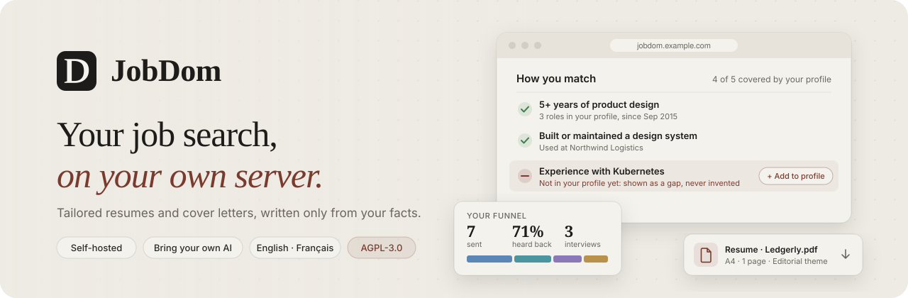
  </picture>
</p>

<p align="center">
  <strong>A self-hosted job search workspace.</strong><br>
  One profile. A tailored resume and cover letter for every job, written only from facts you own.<br>
  Every application tracked from first draft to signed offer, with the AI model <em>you</em> choose.
</p>

<p align="center">
  <a href="LICENSE"></a>
  <a href="https://github.com/AienTech/dossier"></a>
  
  <a href="https://github.com/exhorte/jobdom/commits/main"></a>
  <br>
  
  
  
  
  
  
  
</p>

<p align="center">
  <a href="#-features"><b>Features</b></a> ·
  <a href="#-see-it-in-action"><b>Demo</b></a> ·
  <a href="#-quick-start"><b>Quick start</b></a> ·
  <a href="#-bring-your-own-ai"><b>AI providers</b></a> ·
  <a href="#-architecture"><b>Architecture</b></a> ·
  <a href="#-security--privacy"><b>Security</b></a> ·
  <a href="#-credits--license"><b>License</b></a>
</p>

---

> [!NOTE]
> **JobDom is a fork of [Dossier](https://github.com/AienTech/dossier) by [AienTech](https://github.com/AienTech)**, free software under the AGPL-3.0. It keeps everything Dossier does and adds a **full French interface** (switchable in *Settings → Language*) and first-class **Windows development support**. See [What JobDom adds](#-what-jobdom-adds).

## ✨ Why JobDom?

Job hunting means rewriting the same story fifty times, for fifty postings, in fifty slightly different shapes. JobDom does the rewriting, and leaves the decisions, and the truth, to you.

<table>
  <tr>
    <td width="25%" valign="top">
      <h3>🛡️ Honest by design</h3>
      Drafts use <b>only facts from your profile</b>. A requirement you don't meet is shown as a <i>gap</i>, never papered over. A fact guard flags any name or number that isn't in your profile or the posting.
    </td>
    <td width="25%" valign="top">
      <h3>🏠 Private by default</h3>
      One password, <b>your own PostgreSQL database</b>, your own server. No accounts, no SaaS in between. With a local model, your data never leaves your hardware.
    </td>
    <td width="25%" valign="top">
      <h3>🧠 Bring your own AI</h3>
      Ollama, llama.cpp, LM Studio, any OpenAI-compatible API, Anthropic or Mistral. <b>Switch at any time</b> in Settings. API keys are stored encrypted, and never sent back to the browser.
    </td>
    <td width="25%" valign="top">
      <h3>🎯 You stay in control</h3>
      Nothing is sent, applied for or deleted without you. Every AI edit can be undone, and every document keeps its <b>full version history</b>.
    </td>
  </tr>
</table>

## 🎬 See it in action

<p align="center">
  
</p>

<p align="center"><sub>Recorded with the demo data (Jane Doe is made up) and a stand-in AI that answers at once, at 1.2× speed. With a real model, reading a posting and writing the documents takes from a few seconds to a few minutes.</sub></p>

## 🧭 How it works

From a pasted posting to a sent application, in four steps.

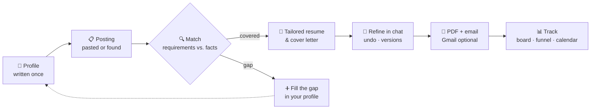

| | Step | What happens |
|:-:|---|---|
| **01** | **Write your profile once** | Basics, skills, languages, experience, projects, education, publications and references, in the order you choose. Import an existing resume (PDF, Word or Markdown) to start. A strength meter counts only what matters. |
| **02** | **Paste a posting** | JobDom extracts the details and requirements and matches them against your profile: what you have is ticked off *with its source*, what you don't is flagged as a gap. |
| **03** | **Get tailored documents** | A resume and a cover letter in the tone you pick (warm, direct or formal), set in one of twelve themes and printed to PDF on your server. |
| **04** | **Track it to an offer** | A Kanban board, a table and a dashboard with your funnel, a week-by-week chart, upcoming interviews and what's worth a look next. |

### What "honest by design" looks like

> **How you match** · *4 of 5 covered by your profile*
>
> ✅ **5+ years of product design**: 3 roles in your profile, since Sep 2015<br>
> ✅ **Built or maintained a design system**: used at Northwind Logistics<br>
> ✅ **Strong prototyping skills in Figma**: used at Fieldnote<br>
> ➖ **Experience with Kubernetes**: *not in your profile yet* · `+ Add to profile`<br>
> ✅ **Dutch is a plus**: Dutch, native
>
> *Gaps aren't dealbreakers. I'll never invent experience. The important ones get addressed honestly in your cover letter.*

## 🚀 Features

<table>
  <tr>
    <td width="50%" valign="top">
      <h4>👤 Profile & base resume</h4>
      <ul>
        <li>Structured profile with drag-and-drop ordering and a strength meter</li>
        <li>Import from <b>PDF, Word or Markdown</b></li>
        <li>Projects, publications (cited in your own style) and references</li>
        <li>Profile photo, with shape and position per theme</li>
        <li><b>12 resume themes</b> and a live theme builder; share themes as files</li>
      </ul>
    </td>
    <td width="50%" valign="top">
      <h4>📝 Tailored applications</h4>
      <ul>
        <li>Requirement extraction and an explained match score</li>
        <li>Resume and cover letter in <b>3 tones</b>, in <b>21 document languages</b></li>
        <li>Chat to refine, regenerate any single part, undo AI changes</li>
        <li>Full document version history and private notes</li>
        <li>Server-side PDF rendering (A4 or Letter), bulk ZIP export</li>
      </ul>
    </td>
  </tr>
  <tr>
    <td valign="top">
      <h4>🔎 Find jobs & startups</h4>
      <ul>
        <li>Search through <b>JSearch</b> (LinkedIn, Indeed and more) or <b>Adzuna</b></li>
        <li>Optional unofficial source for Germany (Bundesagentur für Arbeit)</li>
        <li>Hiring <b>startups</b> from YC job posts and HN “Who is hiring?”, filtered by where you live, robots.txt respected</li>
        <li>Score any posting against your profile, apply in one click</li>
      </ul>
    </td>
    <td valign="top">
      <h4>🤖 Job agent <sup>optional</sup></h4>
      <ul>
        <li>Runs one saved search a day</li>
        <li>Skips what you've already seen, saved or dismissed</li>
        <li>Scores new postings and explains why</li>
        <li>Can prepare drafts that <b>wait for your review</b></li>
        <li>Hard limits on runs, scores and drafts. <b>Never sends or applies.</b></li>
      </ul>
    </td>
  </tr>
  <tr>
    <td valign="top">
      <h4>📬 Gmail & Google Calendar <sup>optional</sup></h4>
      <ul>
        <li>Send from your own address with PDFs attached</li>
        <li>Employers' replies shown next to each application</li>
        <li>AI reads what they ask and drafts an answer from your profile</li>
        <li>Offers interview slots you're actually free for</li>
        <li>Interviews synced both ways with Google Calendar</li>
      </ul>
    </td>
    <td valign="top">
      <h4>🔌 Claude connector (MCP) <sup>optional</sup></h4>
      <ul>
        <li>Use JobDom from Claude (web, desktop, mobile or CLI) <b>on your own Claude plan</b></li>
        <li>Built on the Model Context Protocol, with OAuth</li>
        <li>Tools: <code>search_jobs</code>, <code>get_posting</code>, <code>save_job_scores</code>, <code>get_profile</code>, <code>list_applications</code>, <code>get_application</code>, <code>save_application</code></li>
        <li>Drafts saved by Claude are fact-checked like JobDom's own</li>
      </ul>
    </td>
  </tr>
  <tr>
    <td valign="top">
      <h4>📊 Tracking & insights</h4>
      <ul>
        <li>Kanban board (keyboard accessible) and sortable table</li>
        <li>Funnel over the last 30 days, 90 days or all time</li>
        <li>Weekly activity chart and month/week calendar</li>
        <li>“What's worth a look next” suggestions</li>
      </ul>
    </td>
    <td valign="top">
      <h4>💾 Your data, all of it</h4>
      <ul>
        <li>Export and import <b>everything</b> as one JSON file</li>
        <li>Nightly backups on your server, with retention</li>
        <li>Task data deleted automatically after a delay you choose</li>
        <li><b>Delete everything</b>: one button, and it's gone</li>
      </ul>
    </td>
  </tr>
</table>

### Application lifecycle

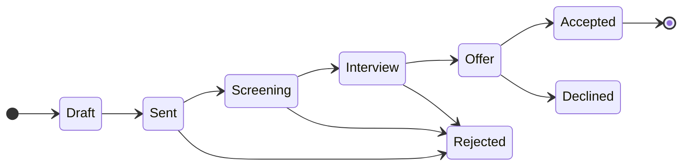

## 🖼️ Screenshots

<p align="center">
  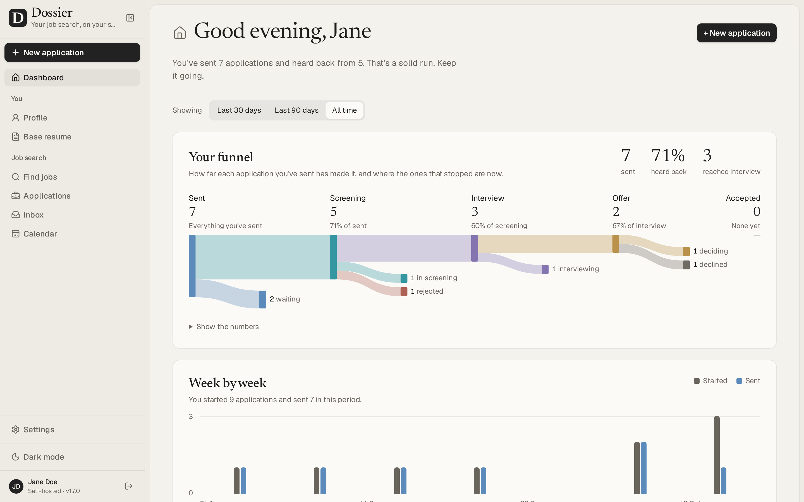
  <br><sub><b>Dashboard</b>: funnel, weekly activity and what's worth a look next</sub>
</p>

<table>
  <tr>
    <td width="50%" align="center">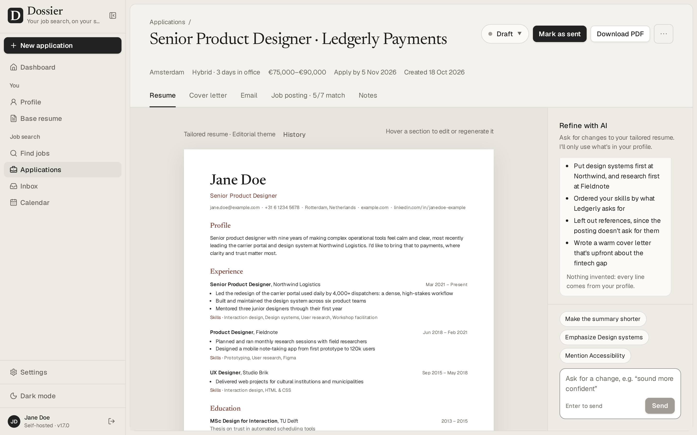<br><sub><b>Application</b>: tailored resume and refine chat</sub></td>
    <td width="50%" align="center">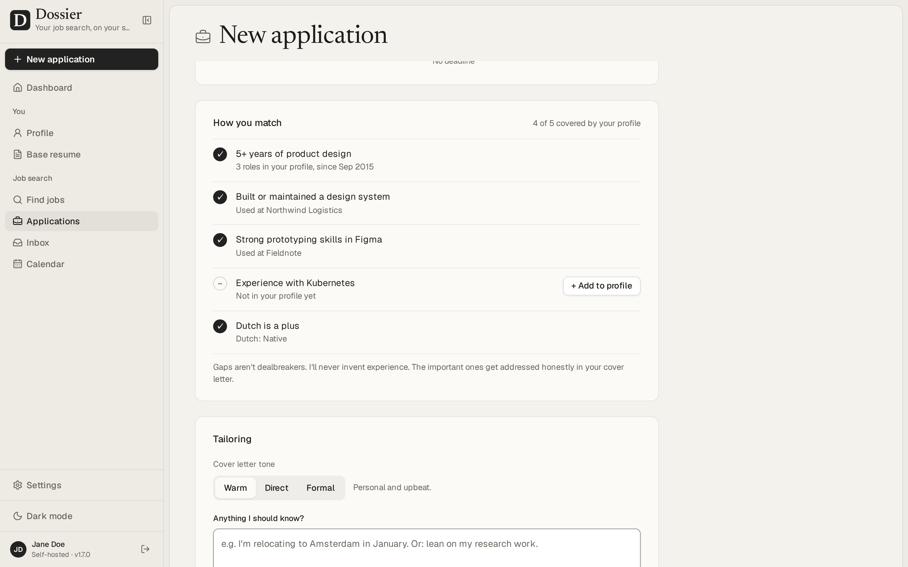<br><sub><b>New application</b>: how you match the posting</sub></td>
  </tr>
  <tr>
    <td align="center">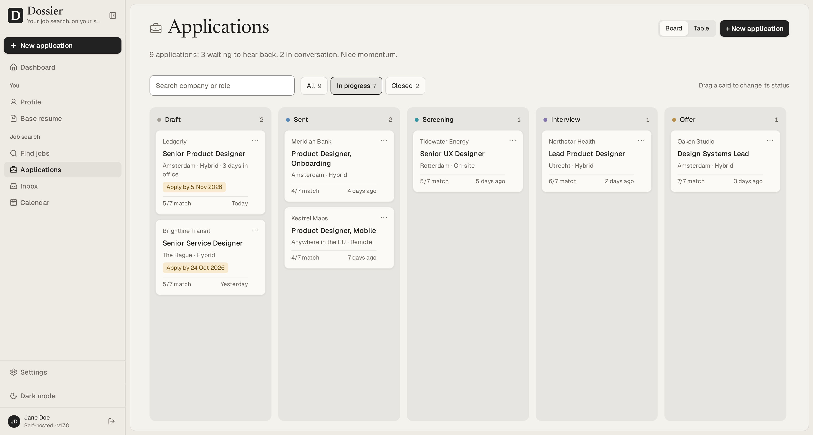<br><sub><b>Board</b>: every application, from draft to offer</sub></td>
    <td align="center">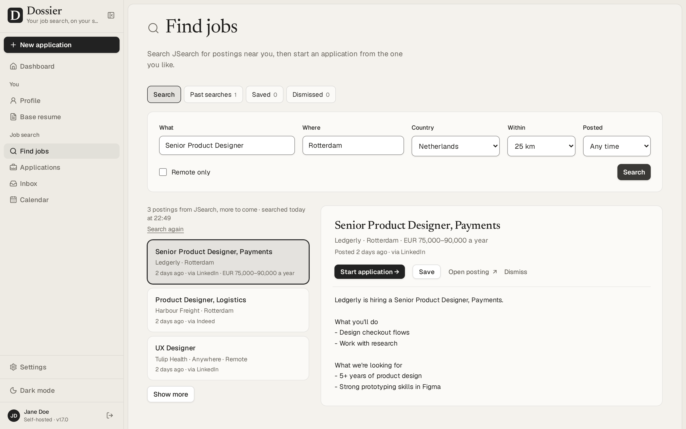<br><sub><b>Find jobs</b>: search, score, apply in one click</sub></td>
  </tr>
  <tr>
    <td align="center">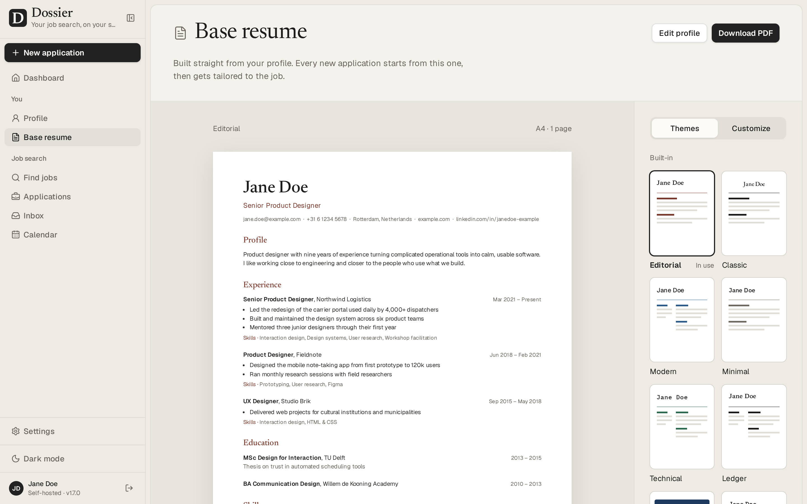<br><sub><b>Base resume</b>: twelve themes and a theme builder</sub></td>
    <td align="center">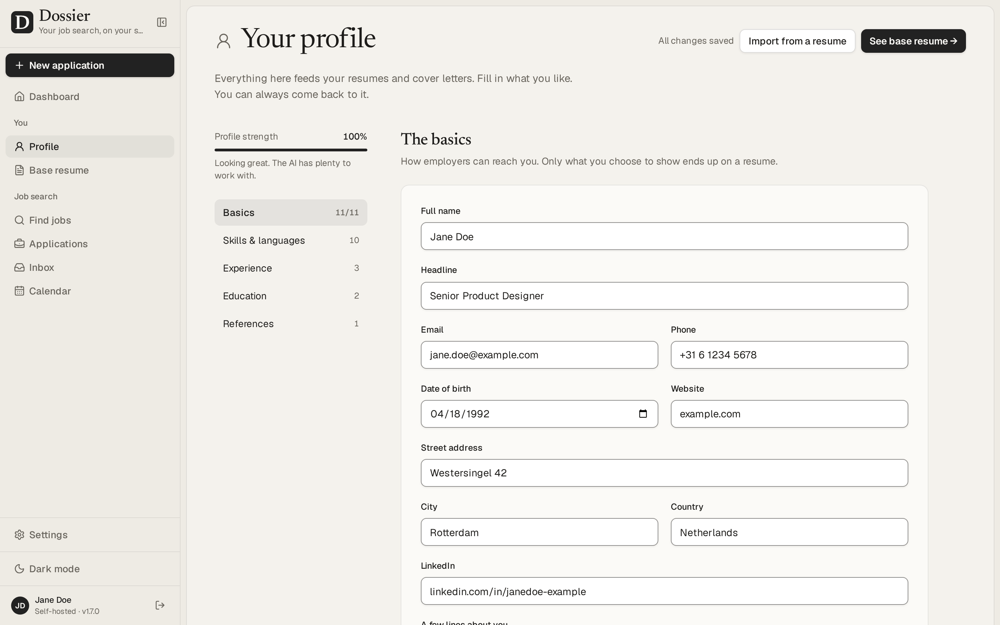<br><sub><b>Profile</b>: the single source of truth</sub></td>
  </tr>
  <tr>
    <td align="center">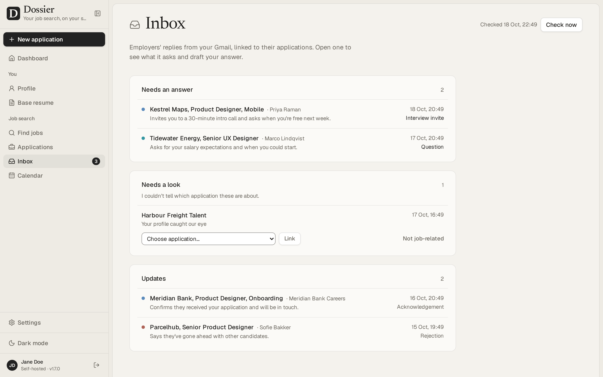<br><sub><b>Inbox</b>: Gmail replies, read and answered by the AI</sub></td>
    <td align="center">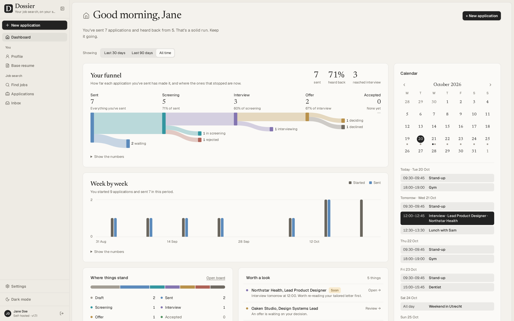<br><sub><b>Calendar</b>: interviews synced with Google Calendar</sub></td>
  </tr>
</table>

<p align="center"><sub>Screenshots show the English interface and the demo data. Switch to French in <i>Settings → Language</i>.</sub></p>

## 🇫🇷 What JobDom adds

| | Dossier 1.9.2 (upstream) | **JobDom** |
|---|:-:|:-:|
| All upstream features | ✅ | ✅ |
| Interface language | English | **English · Français** |
| Language switch | | *Settings → Language* or `DOSSIER_LOCALE` |
| French typesetting (no-break spaces, « guillemets », typographic apostrophes) | | ✅ |
| Locale-aware dates, numbers and lists (`Intl`) | | ✅ |
| Catalog completeness checked by the test suite | | ✅ |
| Native Windows development (PowerShell, no `/tmp`, no shell `cp`) | | ✅ |

Translations live in [`src/lib/i18n`](src/lib/i18n). English is the key, so a missing translation falls back to English, never to a blank. The resume and cover letter languages are separate: pick them in *Settings → Documents*.

## ⚡ Quick start

**You need:** [Docker Desktop](https://docs.docker.com/desktop/) (macOS, Windows) or Docker Engine with Compose (Linux), and about **2 GB of free memory**.

> [!IMPORTANT]
> The published `ghcr.io/aientech/dossier` image is upstream Dossier, without the French interface. To run JobDom, build the image from this repository as shown below.

**1. Clone and build**

```bash
git clone https://github.com/exhorte/jobdom.git
cd jobdom
docker build -t jobdom:local .
```

**2. Create the secrets**

```bash
echo "DOSSIER_IMAGE=jobdom:local"                     >  .env
echo "POSTGRES_PASSWORD=$(openssl rand -hex 24)"      >> .env
echo "DOSSIER_SECRET=$(openssl rand -base64 32)"      >> .env
```

**3. Choose your password**

```bash
docker run --rm -it jobdom:local hash-password
```

It asks for the password twice and prints one line starting with `argon2id:`. Add it to `.env` as `DOSSIER_PASSWORD=argon2id:…`. Only the hash is stored, never the password.

**4. Start it**

```bash
docker compose -f compose.production.yml up -d
```

Open **http://localhost:3000**, sign in, choose your language in **Settings → Language**, then pick a model in **Settings → AI provider**. 🎉

<details>
<summary><b>💻 Development setup (hot reload, Docker or native Node)</b></summary>

<br>

**With Docker (recommended):** everything runs in containers, and the source is bind-mounted.

```bash
cp .env.example .env
docker compose build
docker/bin/yarn hash-password      # put the result in DOSSIER_PASSWORD
# set DOSSIER_SECRET (openssl rand -base64 32) in .env
docker compose up
```

**Native, on Windows:** PostgreSQL in Docker, Node 24 and Yarn 4 (through Corepack) on the host.

```powershell
corepack yarn install --immutable
corepack yarn prisma migrate deploy
corepack yarn prisma db seed            # add `-- --demo` for Jane Doe's sample data
corepack yarn next dev -p 3300 -H 127.0.0.1
```

Every step, verified on Windows 11: **[SETUP.md](SETUP.md)**. Conventions, database, tests and the production image: **[DEVELOPMENT.md](DEVELOPMENT.md)**.

</details>

<details>
<summary><b>🌍 Self-hosting on a server</b></summary>

<br>

Give the server at least **2 vCPUs and 2 GB of memory**, and put a reverse proxy with HTTPS in front of it (the app only listens on `127.0.0.1`). Upstream's installation guide covers every route, and applies to JobDom as well: just use your `jobdom:local` image instead of the published one.

- [Ubuntu server](https://github.com/AienTech/dossier/wiki/Self-host-on-an-Ubuntu-server): Docker Compose + Caddy, or Node.js without Docker
- [Coolify](https://github.com/AienTech/dossier/wiki/Self-host-with-Coolify) · [Dokploy](https://github.com/AienTech/dossier/wiki/Self-host-with-Dokploy) · [CapRover](https://github.com/AienTech/dossier/wiki/Self-host-with-CapRover) (a `captain-definition` is included)

</details>

### Configuration

Everything can be set in the app's **Settings**. Environment variables only provide defaults (the full list is in [`.env.example`](.env.example)).

| Variable | Required | Purpose |
|---|:-:|---|
| `DOSSIER_PASSWORD` | ✅ | argon2id hash of your sign-in password (from `hash-password`) |
| `DOSSIER_SECRET` | ✅ | ≥ 32 characters; encrypts sessions and stored API keys |
| `DATABASE_URL` | ✅ | PostgreSQL connection string (set for you by Compose) |
| `DOSSIER_LOCALE` | | `en` (default) or `fr`: the interface language until one is picked in Settings |
| `DOSSIER_AI_PROVIDER` · `_URL` · `_MODEL` · `_KEY` | | Default AI provider |
| `DOSSIER_JOBS_SOURCE` · `DOSSIER_JSEARCH_KEY` · `DOSSIER_ADZUNA_*` | | Default job source |
| `DOSSIER_GOOGLE_CLIENT_ID` · `_SECRET` · `DOSSIER_PUBLIC_URL` | | Gmail and Calendar integration |
| `DOSSIER_BACKUP_RETENTION_DAYS` | | Nightly backups to keep (default 14) |
| `DOSSIER_TELEMETRY` | | `on` or `off`: answers the opt-in usage ping question in advance |

> [!TIP]
> The server refuses to start, and says which variable to fix, if `DOSSIER_PASSWORD` isn't a valid hash or `DOSSIER_SECRET` is too short.

## 🧠 Bring your own AI

| Provider | Runs where | Your data leaves your hardware? | Cost |
|---|---|:-:|---|
| **Ollama** / llama.cpp | Your machine (a Compose profile is included) | **No** | Free |
| **LM Studio** | Your machine | **No** | Free |
| **OpenAI-compatible** | Any compatible endpoint | Depends on the endpoint | Pay per use |
| **Anthropic** (Claude) | Anthropic API | Yes, what it writes from | Pay per use |
| **Mistral** | Mistral API | Yes, what it writes from | Pay per use |

> [!NOTE]
> **Claude subscription ≠ API key.** A Claude Free, Pro or Max plan can't power JobDom directly (Anthropic's terms forbid it). It works the other way round: turn on the **Claude connector** and let Claude call JobDom. For JobDom to call Claude itself, use an Anthropic API key. Details in [SETUP.md §6 bis](SETUP.md).

To try it locally for free:

```bash
echo "COMPOSE_PROFILES=ai" >> .env && docker compose -f compose.production.yml up -d
docker compose -f compose.production.yml exec ollama ollama pull qwen2.5:3b
# Then in Settings → AI provider: Local model, address http://ollama:11434
```

## 📐 Architecture

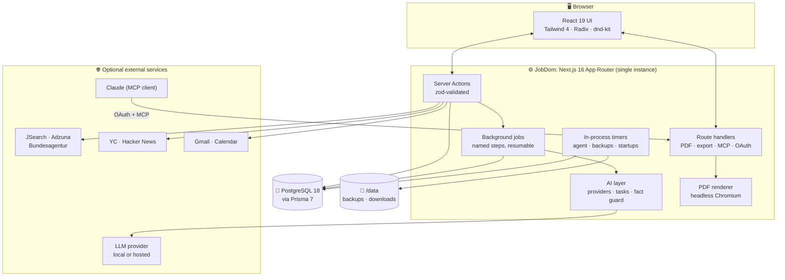

<details>
<summary><b>🧰 Tech stack</b></summary>

<br>

| Layer | Technology |
|---|---|
| Framework | **Next.js 16** (App Router, Server Actions, standalone output), **React 19** |
| Language | **TypeScript 5**, validated end to end with **Zod 4** |
| Styling | **Tailwind CSS 4**, Radix UI primitives, Lucide icons, self-hosted fonts |
| Data | **PostgreSQL 18**, **Prisma 7** (`pg` adapter), 31 migrations |
| AI | OpenAI SDK, Anthropic SDK, Ollama client, structured outputs |
| Documents | `playwright-core` Chromium (PDF), `unpdf` and `mammoth` (resume import), `fflate` (ZIP) |
| Auth | Node `crypto.argon2` (argon2id), `jose` (JWE sessions) |
| Integrations | Google OAuth (Gmail, Calendar), `@modelcontextprotocol/server` |
| Tooling | Yarn 4 (Corepack), ESLint 9, Vitest 5, Playwright, axe-core |
| Delivery | Multi-stage Dockerfile, Docker Compose, CapRover / Coolify / Dokploy ready |

</details>

<details>
<summary><b>📂 Project structure</b></summary>

<br>

```text
.
├── src/
│   ├── app/
│   │   ├── (app)/            # Signed-in screens: dashboard, applications, jobs,
│   │   │                     # startups, agent, inbox, profile, resume, settings
│   │   ├── api/              # Route handlers: PDF, export/import, MCP, OAuth, health
│   │   ├── login/            # Sign-in
│   │   ├── oauth/            # OAuth server for the Claude connector
│   │   └── print/            # Print views rendered to PDF
│   ├── components/           # Shared UI
│   └── lib/
│       ├── ai/               # Providers, prompts (tasks/), fact guard
│       ├── agent/            # Daily job agent
│       ├── auth/             # Password hash, sessions, login throttle
│       ├── connector/        # Claude connector (MCP tools)
│       ├── google/           # Gmail, Calendar, OAuth
│       ├── i18n/             # Translations (fr/)  ← JobDom
│       ├── job-search/       # JSearch, Adzuna, Bundesagentur adapters
│       ├── jobs/             # Background job runner and job definitions
│       ├── pdf/              # Chromium PDF rendering
│       └── startups/         # YC and Hacker News sources, robots.txt
├── prisma/                   # Schema, migrations, seed (+ demo data)
├── e2e/                      # Playwright specs + fake AI, jobs and Google servers
├── docker/                   # Start script and container helpers
├── asset/                    # README images, CI workflows, issue templates
└── site/                     # Static project website
```

</details>

## 🔐 Security & privacy

- **Authentication:** a single password, hashed with **argon2id** (OWASP settings). Sessions are **encrypted JWE cookies** (HttpOnly, SameSite=Lax), 24 h by default or 30 days with “Keep me signed in”.
- **Brute-force protection:** failed sign-ins are rate-limited per IP and globally, with exponential backoff up to 15 minutes.
- **Secrets at rest:** API keys and OAuth tokens are encrypted with keys derived from `DOSSIER_SECRET`, one per kind of secret, and never returned to the browser.
- **Hardened by default:** every mutation checks the session, validates input with Zod and refuses cross-origin requests. Strict Content-Security-Policy. An automated audit test checks that every action and route is protected.
- **External content is untrusted:** startup sites are read politely and their `robots.txt` is followed.
- **Telemetry is opt-in:** JobDom asks once whether it may send a daily ping (a random ID and the version) and sends nothing before you agree. Note that the ping goes to the upstream Dossier project's endpoint; set `DOSSIER_TELEMETRY=off` to never be asked.

Read more in **[SECURITY.md](SECURITY.md)** and **[PRIVACY.md](PRIVACY.md)**.

## ✅ Quality

<p>
  
  
  
</p>

- **212 test files** next to the code: pure logic in Node, components in jsdom, and `*.db.test.ts` against a real PostgreSQL database.
- **End-to-end** tests run a production build against fake AI, job sources and Google servers, so they never spend a real API call.
- **Accessibility:** axe runs on every screen, menu and dialog (no serious or critical WCAG 2.2 AA violations allowed), and keyboard focus is checked.
- Lint, strict type checking and coverage thresholds that can only go up.

```bash
yarn lint && yarn typecheck   # static checks
yarn test                     # unit + database tests
yarn build && yarn test:e2e   # end-to-end, on the production build
```

<details>
<summary><b>⏱️ Performance (measured on 2 vCPUs / 1 GB)</b></summary>

<br>

| Operation | Result |
|---|---|
| Base resume PDF | ~0.25 s (1 s on a cold Chromium start) |
| 6 PDFs requested at once | 1.4 s total (2 render in parallel, the rest queue) |
| Peak memory, Chromium included | ~520 MB (give the container ≥ 768 MB) |
| Dashboard with 90 applications | 20–90 ms |
| Dashboard with 900 applications | ~0.2 s |
| UI interactions | < 32 ms (≈ 100 ms on a CPU 4× slower) |

<sub>Measured by upstream Dossier on its production build.</sub>

</details>

## 🧩 Good to know

| | |
|---|---|
| 🖥️ **Desktop first** | Made for a laptop or desktop browser, not for phones. |
| 👤 **Single user** | One password, one profile, no accounts. |
| 🧱 **One instance** | Run one copy per database: the agent, backups and job queue live in the app's process. |
| 🗂️ **Upstream naming** | Environment variables, the database and some docs still say `DOSSIER_*` / `dossier`, to stay compatible with upstream. |

The status of this fork, what has been verified and how, is tracked in [RECONSTRUCTION_STATUS.md](RECONSTRUCTION_STATUS.md).

## 📚 Documentation

| Document | What's inside |
|---|---|
| [SETUP.md](SETUP.md) | Step-by-step setup on Windows (in French), Claude: API key vs. subscription |
| [DEVELOPMENT.md](DEVELOPMENT.md) | Architecture conventions, database, AI, job search, tests, production image |
| [SECURITY.md](SECURITY.md) | What protects your data, running it safely, reporting a vulnerability |
| [PRIVACY.md](PRIVACY.md) | What stays on your server and what leaves it |
| [UI_REFERENCE.md](UI_REFERENCE.md) | Screen-by-screen UI reference |
| [Upstream wiki](https://github.com/AienTech/dossier/wiki) | AI providers, job sources, Gmail, the Claude connector, backups, upgrading, troubleshooting |

## 🤝 Contributing

Contributions are welcome, and translations especially so.

1. Fork the repository and create a branch: `git checkout -b feat/my-change`
2. Follow the conventions in [DEVELOPMENT.md](DEVELOPMENT.md), and put tests next to the code they cover
3. Run `yarn lint`, `yarn typecheck` and `yarn test`
4. Open a pull request that describes the *why*

Adding a language? Start from [`src/lib/i18n/fr`](src/lib/i18n/fr): `catalog.test.ts` tells you what's missing.

## 📜 Credits & license

JobDom is built on **[Dossier](https://github.com/AienTech/dossier)**, created by **[AienTech](https://github.com/AienTech)**. All credit for the original application goes to its authors. If you find it useful, consider [sponsoring the upstream project](https://github.com/sponsors/AienTech).

Released under the **[GNU Affero General Public License v3.0](LICENSE)**, like the original. You may use, study, change and share it. If you run a modified version for others over a network, you must offer them its source code.

<p align="center">
  <br>
  <sub>Made with care for everyone in the middle of a job search. Good luck out there. 🍀</sub>
  <br><br>
  <a href="#readme-top">↑ Back to top</a>
</p>
